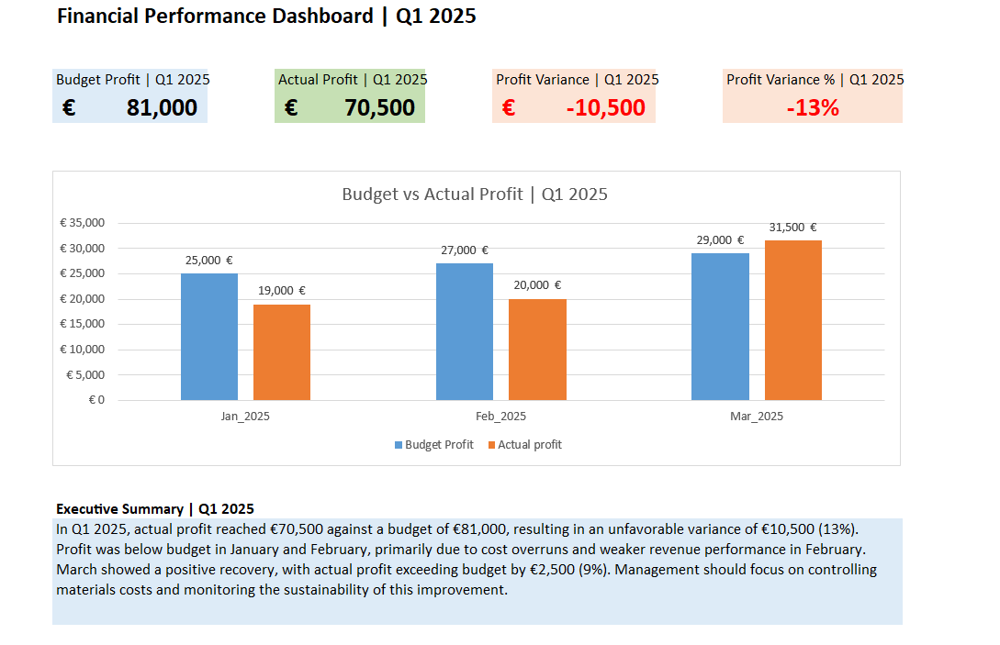

# Financial Controlling & Budget Variance Analysis | Q1 2025
## Project Overview
This Excel portfolio project demonstrates financial controlling, budget monitoring, profit variance analysis, and management reporting for Q1 2025.
## Key Financial Results
- Budget Profit: €81,000
- Actual Profit: €70,500
- Profit Variance: −€10,500 (−13%)
- March Recovery: +€2,500 above budget (+9%)
## Project Features
- Budget vs Actual Analysis
- Monthly Profit Analysis
- Profit Bridge (Waterfall Chart)
- Executive Financial Dashboard
- Management Insights and Recommendations
## Tools & Skills
- Microsoft Excel, SUMIFS, financial variance analysis, conditional formatting, data visualization, and management reporting.
## Executive Dashboard Preview

## Key Insights
- Profit was below budget in January and February, driven by cost overruns and weaker revenue performance in February. March showed a positive recovery. The analysis highlights the importance of materials cost control and regular budget monitoring.
## Project File
- Financial_Controlling_2025.xlsx
- Portfolio project created to demonstrate practical Excel and Financial Controlling skills.
